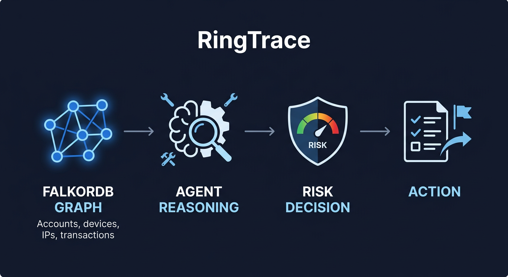

# 🕵️ RingTrace — Fraud-Ring Detective Agent

**Follow the graph. Trace the money. Expose the ring.**

Built for **WeMakeDevs × FalkorDB Graph Hacks 2026 — Track 01: "Agents That Act on Connected Data."**



> ⚠️ **All data in this project is 100% synthetic**, generated by
> `ingestion/generate_synthetic_data.py` specifically for this demo. No real
> people, accounts, devices, IPs, or transactions are represented, and no
> real financial system is ever contacted — every "action" (flagging,
> escalation, watchlisting…) is simulated and only writes to the demo graph.

---

## Table of contents

1. [Problem](#1-problem) · 2. [Why a graph](#2-why-a-graph) · 3. [Why FalkorDB](#3-why-falkordb) · 4. [Track alignment](#4-track-alignment) · 5. [Architecture](#5-architecture) · 6. [Graph schema](#6-graph-schema) · 7. [Agent workflow](#7-agent-workflow) · 8. [Tool layer](#8-tool-layer) · 9. [Graph algorithms](#9-graph-algorithms) · 10. [ML risk scoring](#10-ml-risk-scoring) · 11. [Action system](#11-action-system) · 12. [Evidence model](#12-evidence-model) · 13. [Demo scenarios](#13-demo-scenarios) · 14. [Screenshots](#14-screenshots) · 15. [Setup](#15-setup) · 16. [Docker](#16-docker) · 17. [Environment variables](#17-environment-variables) · 18. [Testing](#18-testing) · 19. [Evaluation](#19-evaluation) · 20. [Limitations](#20-limitations) · 21. [Future roadmap](#21-future-roadmap)

---

## 1. Problem

Fraud rings don't look suspicious one row at a time. A single account, a
single transaction, a single login — in isolation, none of it looks wrong.
What gives a ring away is **structure**: five accounts sharing one device,
money hopping through four intermediaries before landing on one collector
account, a cluster of "unrelated" wallets all logging in from the same IP,
then cashing out through a mixer and spending the proceeds at a real
merchant.

That structure lives naturally in a **graph**. Flattening it into rows for a
classifier (or a prompt for an LLM) throws away exactly the signal that
matters.

## 2. Why a graph

Fraud rings *are* graphs: `Account —TRANSFERRED_TO→ Account`,
`Account —USES_DEVICE→ Device ←USES_DEVICE— Account`,
`Account —TO_MERCHANT→ Merchant`. Two graph primitives do most of the real
work here:

- **Weakly Connected Components (WCC)** instantly isolates "who is in this
  ring with me" — the alternative (self-joins / recursive SQL CTEs) gets
  ugly and slow fast.
- **PageRank** over the money-flow graph identifies the *ring leader* — the
  account that disproportionately collects funds — with zero hand-tuned
  heuristics.

Component *membership* alone is a weak signal, though (see [Section 9](#9-graph-algorithms)
for why RingTrace replaced a naive "size ≥ 3 = ring" check with a transparent
composite score) — which is itself only possible because the graph exposes
the finer-grained signals (shared-identity density, reciprocal flow, broker
concentration) that a flattened table would have thrown away.

## 3. Why FalkorDB

FalkorDB was chosen because it's a **property graph with those algorithms
built in** (`CALL algo.WCC(...)`, `CALL algo.pageRank(...)`) and speaks
**Cypher** over a **Redis-compatible wire protocol**, so the whole stack
(graph + "cache" + pub/sub if needed later) is one lightweight service — a
good fit for a hackathon MVP that still "looks production-capable."

**FalkorDB is not merely used to visualize RingTrace relationships. It is the
live graph context layer used by the agent to investigate connected evidence,
make decisions, and trigger actions.**

Every tool the agent calls (`find_fraud_ring`, `rank_ring_leaders`,
`trace_money_path`, `find_identity_links`, `calculate_risk_score`) issues
real Cypher/`algo.*` calls against FalkorDB, and the **structured results of
those calls are what the decision engine reads** to pick a verdict (see
`agent/decision.py`). Change the graph — remove a shared device, delete a
money edge — and the verdict changes. That's demonstrated explicitly in
[Section 13](#13-demo-scenarios) and asserted directly in
`tests/test_decision.py::test_verdicts_differ_across_cases`.

**On GraphRAG-SDK:** evaluated and deliberately NOT used. RingTrace's tool
layer already issues precise, parameterized Cypher per investigative
question (ring detection, leader rank, money path, identity links) — that's
a more auditable and judge-legible "show your work" story than routing
those same questions through a RAG abstraction on top of the graph. Adding
it here would dilute the graph-first architecture without solving a problem
RingTrace actually has. If a future version needs open-ended natural-language
graph Q&A beyond the fixed tool set, GraphRAG-SDK would be the right place
to revisit this decision.

## 4. Track alignment

Track 01 asks for **"Agents That Act on Connected Data."** RingTrace is
built so that claim is falsifiable, not aspirational:

- **Connected data**: the graph (Person/Account/Device/IP/Broker/Merchant/
  Transaction/Alert + derived `LINKED_TO` identity-resolution edges) is the
  *only* source of investigative truth — no flat feature table is computed
  outside the graph.
- **Agent**: a real tool-calling loop (LLM-driven when configured, or a
  deterministic rule-based planner) dynamically decides which graph query to
  run next based on what the *previous* query actually returned.
- **Acts**: the agent doesn't just report a verdict — it writes real,
  auditable nodes back into the graph (`Case`, `Evidence`, `GraphFinding`,
  `Action`, `WatchlistEntry`) via simulated-but-real graph mutations.

## 5. Architecture

```
┌──────────────┐   Cypher / algo.*   ┌───────────────────────────────┐
│   FalkorDB   │◄───────────────────►│   tools/  (MCP-style layer)   │
│ (graph store │                     │  19 tools (7 required + 5     │
│  + WCC/PageRank)                   │  optional + 7 action), typed  │
└──────────────┘                     └───────────────┬───────────────┘
                                                       │ ToolResult
                                      ┌────────────────▼───────────────┐
                                      │   agent/   (reasoning loop)    │
                                      │ LLM tool-calling  OR           │
                                      │ deterministic rule-based       │
                                      │ planner (agent/rule_based.py)  │
                                      └────────────────┬───────────────┘
                                                        │ evidence_trail
                                      ┌─────────────────▼──────────────┐
                                      │ agent/decision.py                │
                                      │ transparent rules -> verdict,    │
                                      │ confidence, recommended_action   │
                                      └─────────────────┬──────────────┘
                                                         │
                 ┌───────────────────────────────────────▼─────────────┐
                 │ FastAPI `api/main.py` — REST API + SPA on :8000     │
                 │ React/Vite `frontend/` + native SVG graph renderer  │
                 │ `/api/*` and client routes share one public origin │
                 │ legacy Streamlit baseline remains in `app/`         │
                 └───────────────────────────────────────────────────────┘
```

Models (`models/`) compute graph-derived features (degree, PageRank,
component size, shared-identifier counts, hop-distance to known alerts…)
and feed a RandomForest classifier; `models/risk_scorer.py` additionally
applies a **graph-evidence guardrail** (Section 10) on top of the raw model
score so the final number always stays grounded in what the graph actually
shows.

## 6. Graph schema

**Node labels:** `Person`, `Account`, `Device`, `IP`, `Transaction`,
`Broker`, `Merchant`, `Alert`, plus agent-written `Case`, `Evidence`,
`GraphFinding`, `Action`, and `WatchlistEntry` nodes.

**Relationships:**

| Relationship | Direction | Meaning |
|---|---|---|
| `OWNS` | Person → Account | Account ownership |
| `USES_DEVICE` | Account → Device | Device used to access an account |
| `LOGGED_FROM` | Account → IP | Login/session IP |
| `TRANSFERRED_TO` | Account → Account | Denormalized money-flow edge (drives PageRank) |
| `ROUTED_THROUGH` | Account/Transaction → Broker | Funds routed through a broker/mixer |
| `FROM` / `TO` | Transaction → Account | Transaction endpoints |
| `TO_MERCHANT` | Transaction → Merchant | One-sided merchant purchase (no destination Account) — completes realistic end-of-chain narratives like Account → Broker → Account(self) → Merchant |
| `FLAGS` | Alert → Account | Existing rules-engine alert |
| `LINKED_TO` | Account → Account | **Materialized identity-resolution edge** — derived at load time from shared device / IP / owning person / broker / direct transfer. This is what makes `algo.WCC` directly usable for ring detection. |
| `INVESTIGATES` | Case → Account | Agent-created case record (original, unchanged) |
| `HAS_CASE` | Account → Case | Reciprocal of `INVESTIGATES`, added for the evidence-provenance graph (Section 12) |
| `SUPPORTED_BY` | Case → Evidence | Human-readable reasoning line behind a case |
| `RESULTED_IN` | Case → Action | What the agent actually did |
| `TRIGGERED_BY` | Action → GraphFinding | The specific graph finding that justified the action |
| `WATCHES` | WatchlistEntry → entity | Agent-created watchlist entry |

Indexes are created on every `.id` property plus a few hot filter fields
(see `graph/schema.py`) so lookups stay O(log n) as the graph grows.

### Sample Cypher — inspect the graph yourself

Run these directly with `redis-cli` (`GRAPH.QUERY ringtrace "..."`), an
optionally exposed FalkorDB Browser UI, or
`python -c "from graph.connection import get_graph; print(get_graph().query('...').result_set)"`.
The default Compose setup keeps FalkorDB private; the judge-facing app is
available at one URL on port 8000.

```cypher
// Ring members of the Case C demo ring
MATCH (a:Account {id: 'A1027'})
CALL algo.WCC({nodeLabels: ['Account'], relationshipTypes: ['LINKED_TO']})
YIELD node, componentId
WITH componentId AS target_cid WHERE node.id = 'A1027'
WITH target_cid
CALL algo.WCC({nodeLabels: ['Account'], relationshipTypes: ['LINKED_TO']})
YIELD node, componentId
WHERE componentId = target_cid
RETURN collect(node.id) AS ring_members;

// Highest PageRank accounts (likely ring leaders) by money flow
CALL algo.pageRank('Account', 'TRANSFERRED_TO')
YIELD node, score
RETURN node.id AS account_id, score
ORDER BY score DESC LIMIT 10;

// The money path from an alerted account to its ring leader
MATCH p = (a:Account {id: 'A1027'})-[:TRANSFERRED_TO*1..6]->(b:Account {id: 'A1001'})
RETURN [n IN nodes(p) | n.id] AS path, length(p) AS hops;

// Accounts sharing a device with a given account
MATCH (a:Account {id: 'A1027'})-[:USES_DEVICE]->(d:Device)<-[:USES_DEVICE]-(other:Account)
RETURN d.id, collect(DISTINCT other.id) AS other_accounts;

// Full action history + what graph finding triggered each action
MATCH (c:Case)-[:RESULTED_IN]->(ac:Action)-[:TRIGGERED_BY]->(gf:GraphFinding)
RETURN c.account_id, ac.action_type, ac.created_at, gf.summary
ORDER BY ac.created_at DESC LIMIT 20;
```

## 7. Agent workflow

```
understand target → get_account_context
        │
        ▼
   is it in a ring?  ──no──► skip ring tools, still check identity links
        │ yes (is_ring OR ring_score ≥ 0.2)
        ▼
  rank_ring_leaders  → identify leader (PageRank)
        │
        ▼
  trace_money_path(account → leader)  → confirm the flow
        │
        ▼
  find_identity_links  → confirm WHY these accounts are connected
        │
        ▼
  calculate_risk_score → explainable ML score (+ graph guardrail)
        │
        ▼
  generate_verdict → numbered reasoning, ring score/leader/path, confidence, action
```

Two interchangeable planners implement this:

- **LLM mode** (`agent/llm.py` + `Investigator._run_llm_loop`): if
  `LLM_PROVIDER` + `LLM_API_KEY` are set (works with Groq, OpenAI, or any
  OpenAI-compatible endpoint), an LLM with function/tool-calling picks the
  next tool after reading each previous tool's *actual* JSON output — real
  dynamic tool selection, not a canned script. **No live LLM key is
  available in the environment this was engineered in**, so this path is
  verified with a scripted-but-honest mocked-client contract test instead
  (`tests/test_llm_loop_mocked.py` — see [Section 18](#18-testing)); it
  exercises the exact `tool_calls[i].function.{name,arguments}` /
  `.model_dump()` shape the real OpenAI SDK returns, including the
  max-iteration guard and rejection of non-investigation tools. Anyone with
  a Groq/OpenAI key can flip `LLM_PROVIDER` in `.env` and exercise the real
  path end-to-end — the code path is identical either way.
- **Rule-based mode** (`agent/rule_based.py`, the default — **no API key
  required**): a deterministic planner follows the same methodology but
  skips steps the evidence doesn't justify. The demo is never broken by a
  missing/rate-limited LLM key, and this remains the **permanent fallback**,
  not a mode slated for removal.

In **both modes**, the actual verdict is produced by
`agent/decision.py::build_verdict`, reading the structured `evidence_trail`
— never by free-form LLM text. This keeps every decision auditable and
exactly reproducible from the graph evidence collected, independent of which
planner ran.

## 8. Tool layer

Every tool is a `ToolSpec`: a name, an LLM-facing description (**explaining
WHEN to call it**, not just what it does), a Pydantic input model (typed,
validated), and a handler that **always returns a `ToolResult`** —
tools never raise; failures become `{ok: False, error: "..."}` so the agent
loop degrades gracefully instead of crashing.

### Investigation tools (read-only, pure graph queries)

| Tool | Graph operation | When the agent should call it |
|---|---|---|
| `get_account_context` | 1-hop neighborhood fetch (now includes merchant purchases) | Always first — establishes what we know about the target. |
| `find_fraud_ring` | `algo.WCC` over `LINKED_TO` + composite ring score | To check whether the account belongs to a larger connected structure, and how strongly that structure actually looks like a ring. |
| `rank_ring_leaders` | `algo.pageRank` over `TRANSFERRED_TO` | Once a ring is found, to identify the likely leader/mule. |
| `trace_money_path` | Variable-length path over `TRANSFERRED_TO` | To see exactly how money moves between the account and a suspicious endpoint. |
| `find_identity_links` | Shared-device/IP/person/broker lookups | To explain *why* accounts are connected (confirms the ring isn't coincidental). |
| `calculate_risk_score` | Graph feature extraction + RandomForest + guardrail | To get an explainable, numeric severity for a verdict. |
| `generate_verdict` | Synthesizes the evidence trail | Final step — call once sufficient evidence has been gathered. |
| `timeline_analysis` *(optional)* | Chronological transaction ordering | To spot bursty/velocity patterns. |
| `broker_analysis` *(optional)* | Broker/mixer fan-in analysis | When a broker shows up in a money path. |
| `compare_accounts` *(optional)* | Side-by-side feature diff | To contrast a suspicious account against a clean one. |
| `investigate_entity` *(optional)* | Generalized entity lookup (device/IP/person) | When the query starts from a non-account entity. |
| `generate_case_report` *(optional)* | Builds the full Markdown report | For display/export without necessarily ending the investigation. |

### Action tools (simulated, graph-mutating)

| Tool | What it writes |
|---|---|
| `create_investigation_case` | A `Case` node linked to the account via `INVESTIGATES` |
| `flag_account` | `Account.flagged = true` + reason |
| `mark_high_risk` | `Account.risk_level = 'HIGH'`, `status = 'UNDER_REVIEW'` |
| `request_manual_review` | `Account.status = 'MANUAL_REVIEW_REQUESTED'` |
| `escalate_case` | `Case.status = 'ESCALATED'` |
| `add_to_watchlist` | A `WatchlistEntry` node `WATCHES` any entity (account/device/IP/person/broker) |
| `export_case_summary` | Writes a downloadable Markdown case summary report to `reports/` |

`agent/decision.py::execute_recommended_action` additionally writes the
second-order evidence graph (`HAS_CASE`/`SUPPORTED_BY`/`RESULTED_IN`/
`TRIGGERED_BY`, see [Section 12](#12-evidence-model)) around every action —
this is internal bookkeeping, not a new LLM-selectable tool, so the tool
surface the agent reasons over stays small and auditable.

## 9. Graph algorithms

RingTrace prefers **real FalkorDB graph algorithms over Python/NetworkX
reimplementations** everywhere one exists:

| Need | FalkorDB primitive used | NOT done |
|---|---|---|
| Ring membership | `CALL algo.WCC({nodeLabels:['Account'], relationshipTypes:['LINKED_TO']})` | No Python Union-Find over fetched edges |
| Ring leader | `CALL algo.pageRank('Account', 'TRANSFERRED_TO')` | No manual in-degree/weight heuristic |
| Money trail | `MATCH p = (a)-[:TRANSFERRED_TO*1..6]->(b) RETURN p` (variable-length path match) | No BFS implemented client-side |
| Identity distance | `shortestPath((a)-[:LINKED_TO*..8]->(b))` | — |

### The ring-score composite (replaces the old "size ≥ 3" heuristic)

A naive "component size ≥ 3 ⇒ ring" check has a real, measured failure
mode in this dataset: the legitimate background population is only loosely
partitioned into small "circles," so cross-circle noise transactions
transitively merge much of it into one large connected component over time
(confirmed by `evaluation/investigation_eval_report.json`: a 153-account
component containing mostly unrelated legit accounts). Component size alone
would flag the majority of innocent accounts.

`find_fraud_ring` now also computes a **transparent composite ring score**
(`tools/investigation.py::_find_fraud_ring`), blending nine independently
auditable, parameterized-Cypher-backed signals:

| Signal | Query | Weight |
|---|---|---|
| Component size | `weakly_connected_components` | 0.15 |
| Shared-device pair density | `shared_identity_pair_counts` | 0.15 |
| Shared-IP pair density | `shared_identity_pair_counts` | 0.10 |
| Reciprocal transfer density | `reciprocal_transfer_pairs` | 0.15 |
| Internal transaction density | `component_txn_stats` | 0.10 |
| Broker/mixer concentration | `component_broker_count` | 0.10 |
| Alerted-member ratio | `component_alert_count` | 0.10 |
| PageRank concentration | `pagerank` filtered to members | 0.10 |
| Transaction velocity | derived from `component_txn_stats` timestamps | 0.05 |

The tool returns `ring_score` (0–1), `ring_confidence` (how many distinct
signal *types* corroborate it — one strong signal alone yields a low
confidence even with a moderate score), and `ring_reasons` (plain-English,
one line per fired signal). The legacy `is_ring` boolean is **kept for
backward compatibility**, but `agent/rule_based.py` and
`agent/decision.py` now read `ring_score`/`ring_confidence`, not just the
boolean — e.g. the planner digs deeper (`rank_ring_leaders`,
`trace_money_path`) whenever `ring_score ≥ 0.2`, even for 2-account
components the old size threshold would have ignored outright (see
`DEMO-06` in [Section 13](#13-demo-scenarios)).

## 10. ML risk scoring

`models/features.py` computes, per account, purely graph-derived features:
degree & weighted degree on `LINKED_TO`, PageRank on both the identity graph
and the money-flow graph, connected-component size, counts of accounts
sharing a device/IP, transaction count & total amount, net flow, hop-distance
to the nearest known `Alert`, broker count, and the fraction of
directly-linked neighbors that are themselves already flagged
(`suspicious_neighbor_ratio`).

`models/train.py` trains a `RandomForestClassifier` against
`data/processed/ground_truth.csv` — **synthetic ground truth only, used for
training/evaluation, never written onto graph nodes** (the agent cannot
"cheat" by reading a label; it has to infer risk from structure, like a real
investigator). The fresh post-fix run used **219 labeled accounts** with a
stratified 25% holdout (**164 train / 55 test**, `random_state=42`) and the
existing 17-feature schema. The 200-tree forest (`max_depth=8`,
`min_samples_leaf=2`, `class_weight="balanced"`) scored **accuracy 0.945,
precision 0.882, recall 0.938, F1 0.909, ROC-AUC 0.995** on that synthetic
holdout. These are synthetic-only metrics; per-account `predict_proba` values
are raw model scores, **not calibrated real-world fraud probabilities**. The
regenerated `evaluation/synthetic_eval_report.json` records the ground-truth
SHA-256, split parameters, feature order, and classifier settings for
reproducibility. Independent aggregation of outgoing, incoming, and linked
relationships keeps identity fan-out from inflating the monetary features.

> Honesty note: an earlier version of this dataset (without the deliberately
> ambiguous/benign look-alike scenarios) scored a suspicious 1.00 across
> every metric. Adding DEMO-02/DEMO-05 (benign shared-signal look-alikes) and
> DEMO-06 (genuinely ambiguous) made the problem slightly harder and the
> metrics correspondingly — and more credibly — less than perfect. This is
> reported as-is, not tuned back to 1.00.

### The graph-evidence guardrail

A small RandomForest trained on a few hundred synthetic accounts can be
over-confident at the margins. RingTrace adds a transparent, rule-based
**guardrail** (`_graph_evidence_strength` in `models/risk_scorer.py`) that
caps the raw ML score based on what the graph actually shows:

- **No shared identifiers, no alerts, no ring membership** → capped at 0.20
  (LOW), regardless of what the model predicts.
- **Weak evidence** → capped at 0.55.
- **Identity linkage confirmed (shared device/IP, ring membership) but no
  confirmed money trail and no nearby alert** → capped at 0.72 (HIGH, not
  CRITICAL).
- **Strong evidence** (ring + money trail + alert proximity) → the raw model
  score passes through untouched.

The dashboard's **D. Risk** panel shows both `raw_model_score` and the final
graph-adjusted `risk_score` whenever the guardrail fires.

**A genuinely interesting, honestly-reported side effect of the guardrail:**
in a layered-movement ring, the *leader* (who routes through a broker and
spends at a merchant) correctly scores HIGH, while a quiet *feeder* account
one hop earlier in the same ring — with no identity-link or broker evidence
of its own — scores LOW, even though it's ground-truth fraud. This is a
conscious design choice (no guilt-by-association without corroborating
evidence of the account's *own* behavior), confirmed and reported, not hidden,
in `evaluation/investigation_eval_report.json` (`false_negative_examples`).

## 11. Action system

The agent doesn't just output a verdict — it **writes real, auditable graph
mutations**, all explicitly simulation-only (no real system is ever
contacted):

```
verdict → execute_recommended_action()
   ├─ create_investigation_case   (always)
   ├─ ESCALATE_FOR_MANUAL_INVESTIGATION → flag_account + mark_high_risk +
   │                                      request_manual_review + escalate_case
   ├─ FLAG_AND_REQUEST_MANUAL_REVIEW     → flag_account + request_manual_review
   ├─ ADD_TO_WATCHLIST                   → add_to_watchlist
   └─ NO_ACTION_REQUIRED                 → (case record is the only artifact)
```

Every action is immediately visible on re-investigation (the next
`get_account_context` call will show the updated `flagged`/`status`
properties) — the graph write-back is real, not a dashboard-only toast.

## 12. Evidence model

Two complementary representations of "why":

**1. The in-memory verdict dict** (`agent/decision.py::build_verdict`),
matching the shape `{claim, evidence[], tools_used[], risk_score,
confidence, action}`:

```python
{
  "verdict": "FRAUD RING CONFIRMED",            # claim
  "reasoning": [...],                           # evidence[]
  "tools_used": ["find_fraud_ring", ...],       # tools_used[]
  "risk_score": 0.99, "confidence": 0.95,       # risk_score, confidence
  "recommended_action": "ESCALATE_FOR_MANUAL_INVESTIGATION",  # action
  "ring_score": 0.43, "ring_confidence": 0.89, "ring_reasons": [...],
  ...
}
```

**2. The second-order evidence graph**, written into FalkorDB itself
(additive — the original `Case-[:INVESTIGATES]->Account` write is untouched):

```
(Account)-[:HAS_CASE]->(Case)-[:SUPPORTED_BY]->(Evidence)
                           │
                           └─[:RESULTED_IN]->(Action)-[:TRIGGERED_BY]->(GraphFinding)
```

This means "why did RingTrace take this action?" is not just a UI panel —
it's a literal, queryable graph fact (see the sample Cypher in
[Section 6](#6-graph-schema)). The React investigation workspace surfaces
the provenance panel and evidence ledger alongside the native SVG graph,
agent trace, and a confirmation-based simulated Action Center. GRAPH FACTS
→ TOOL CALLS → EVIDENCE → RISK → DECISION → ACTION are rendered from the
actual API result and tool evidence, not fabricated or re-derived.

## 13. Demo scenarios

### Fixed cases (the original 3, unchanged)

| ID | Case | Graph evidence | Risk class | Action |
|---|---|---|---|---|
| `A1100` | **A — isolated** | 1 linked account, no shared devices/IPs, no alerts | **LOW** | `NO_ACTION_REQUIRED` |
| `A1200` | **B — identity-linked only** | 5-account component, 4 share an IP, no money trail | **HIGH** | `FLAG_AND_REQUEST_MANUAL_REVIEW` |
| `A1027` | **C — ring + money flow** | 9-account component, shared device (7 accts), PageRank leader `A1001`, 5-hop money trail, pre-existing alert, leader spends mixer proceeds at a synthetic merchant | **CRITICAL** | `ESCALATE_FOR_MANUAL_INVESTIGATION` |

Identical decision logic run against three different graph neighborhoods
produces three genuinely different outcomes — asserted directly in
`tests/test_decision.py::test_verdicts_differ_across_cases`.

### Additive scenarios (DEMO-01 … DEMO-06)

Added to broaden coverage without touching the cases above — including two
deliberate **benign look-alikes** that a naive detector would wrongly flag:

| ID | Account(s) | What it tests |
|---|---|---|
| `DEMO-01` | `A1300` | Trivial clean/isolated account — sanity check for LOW. |
| `DEMO-02` | `A1310`/`A1311` | **Benign**: shared device, zero money movement (e.g. household). Must NOT escalate on identity-link alone. |
| `DEMO-03` | `A1320`-`A1323` | Reciprocal wash-trading ring — dense back-and-forth money flow, **no shared identity at all**. Tests the reciprocal-transfer signal specifically. |
| `DEMO-04` | `A1330`→`A1331`→`A1332` | Full layered-movement chain ending in a broker cash-out **and a synthetic merchant purchase**. |
| `DEMO-05` | `A1340`/`A1341` | **Benign**: two unrelated accounts who happen to shop at the same popular merchant. Must NOT be treated as a ring signal. |
| `DEMO-06` | `A1350`/`A1351` | Genuinely **ambiguous** — one shared device, one small transfer, nothing else. A well-calibrated agent should land on a measured verdict, not an overconfident one. |

See `docs/DEMO_SCRIPT.md` for the full narrated 3–5 minute walkthrough, and
`evaluation/investigation_eval_report.json` for how well the agent actually
performs on all of the above, measured against synthetic ground truth.

## 14. Screenshots

No screenshots are bundled; mockups are not presented as real captures.
The production React interface is served by FastAPI on port `8000`; its root,
client-side routes, built JS/CSS assets, and live `/api/*` endpoints have
been smoke-tested against the seeded FalkorDB graph. Use the setup below to
open the actual running workspace. The existing screenshot helper targets
the preserved Streamlit baseline and is not a React browser-test harness.

## 15. Setup

### Option A — Docker (recommended)

```bash
cp .env.example .env     # optional; the rule-based agent needs no LLM key
docker compose up --build
```

Open **http://localhost:8000**. FastAPI serves both the React SPA and its
`/api/*` routes on this single URL; FalkorDB stays private inside the Compose
network. On first startup, the app loads the synthetic demo graph and trains
the risk model if the graph is empty.

### Option B — Local development

```bash
python3 -m venv .venv && source .venv/bin/activate
pip install -r requirements.txt
cp .env.example .env
npm --prefix frontend ci
npm --prefix frontend run build

./scripts/setup_falkordb_local.sh      # starts FalkorDB via Docker if available
./scripts/run_pipeline.sh              # generate data + load graph + train model
uvicorn api.main:app --env-file .env --host 0.0.0.0 --port 8000
```

Open **http://localhost:8000**. If Docker is unavailable, point
`FALKORDB_HOST`/`FALKORDB_PORT` in `.env` at a reachable FalkorDB service
instead of running the local-DB helper.

For development without a build, run these in separate terminals:

```bash
uvicorn api.main:app --env-file .env --host 0.0.0.0 --port 8000
npm --prefix frontend run dev
```

Vite proxies `/api` to FastAPI; open **http://localhost:5173** while using
the development server. The original Streamlit implementation remains
available separately with `streamlit run app/dashboard.py
--server.address 0.0.0.0 --server.port 8501`.

All scenarios are synthetic. `A1027` is a deterministic seeded demo account,
not a real customer or fraud allegation.

## 16. Docker

The Compose stack contains two services: `falkordb` (healthchecked and
private to the Compose network) and `ringtrace`. The multi-stage Dockerfile
builds the Vite frontend with Node, copies the production assets into the
Python image, and serves them together with FastAPI. On first startup, the
entrypoint seeds the synthetic graph and trains the model if the graph is
empty.

```bash
docker compose up --build
```

The only published application port is **8000** (`http://localhost:8000`).
Redis/FalkorDB and its optional browser UI are not published to the host by
default, so the judge-facing app has one URL.

**Honest disclosure:** Docker/Podman is not installed in this sandbox, so a
container build/run has not been performed here. The Compose YAML, entrypoint
shell syntax, production API, SPA routes/assets, graph-backed A1027
investigation, and graph write-back were validated separately in the local
environment. Validate the actual image with `docker compose up --build` on a
host with Docker before deployment.

## 17. Environment variables

See `.env.example` for the full annotated list. Highlights:

| Variable | Purpose | Default |
|---|---|---|
| `FALKORDB_HOST` / `FALKORDB_PORT` | Where to reach FalkorDB | `localhost:6379` |
| `FALKORDB_GRAPH` | Graph name | `ringtrace` |
| `FALKORDB_USERNAME` / `FALKORDB_PASSWORD` | Optional graph authentication | _(empty)_ |
| `LLM_PROVIDER` | `none` \| `groq` \| `openai` | `none` (rule-based fallback) |
| `LLM_API_KEY` | API key — **never hardcoded**, read from env only | _(empty)_ |
| `LLM_BASE_URL`, `LLM_MODEL` | OpenAI-compatible endpoint + model | Groq `llama-3.3-70b-versatile` |
| `LLM_TIMEOUT_SECONDS`, `LLM_MAX_TOOL_ITERATIONS` | Guardrails against a hung/looping agent | `20`, `8` |
| `RING_COUNT`, `ACCOUNTS_PER_RING`, `LEGIT_PERSON_COUNT`, `NORMAL_TRANSACTION_COUNT`, `NOISE_LEVEL`, `FRAUD_RATIO`, `RANDOM_SEED` | Synthetic data generator knobs | see `.env.example` |

## 18. Testing

Build the frontend and run the repository's explicit test directory. Graph-backed
tests include mutations, so they require an explicitly opted-in disposable
FalkorDB instance loaded with the synthetic demo graph. The harness refuses to
probe or mutate port `6379` even if the opt-in flag is set; without a safe target,
graph-dependent tests skip without connecting.

```bash
npm --prefix frontend ci
npm --prefix frontend run build
# Configure the following variables for your disposable FalkorDB instance (not 6379):
RINGTRACE_TEST_DISPOSABLE=1 FALKORDB_HOST=127.0.0.1 FALKORDB_PORT=6380 \
FALKORDB_GRAPH=ringtrace PYTHONPATH=. pytest tests/ -q
```

The validation run on a seeded disposable instance completed **74 tests, all
passing**. Current coverage is split across:

- `test_api.py` (36) — FastAPI contracts, investigation/result routes,
  graph/evidence/trace exports, server-enforced approval and explicit
  confirmation, durable case summaries, built SPA routes/assets, and API
  fallbacks.
- `test_actions.py` (1) and `test_context.py` (1) — failed graph-case writes
  stop follow-on actions, and graph IDs remain unique across independent
  tool contexts.
- `test_tools.py` (10) and `test_decision.py` (4) — graph tools, known
  scenarios, and LOW/HIGH/CRITICAL outcomes from different graph structures.
- `test_integration_falkordb.py` (16 collected cases across 12 test functions) —
  real graph schema, parameterized transfer-total fan-out/zero-match regression,
  graph-evidence guardrails, investigation fallback, and the persisted second-order action
  trail (`HAS_CASE`, `SUPPORTED_BY`, `RESULTED_IN`, `TRIGGERED_BY`), all only
  on the explicitly configured disposable graph.
- `test_risk_scorer.py` (3) — unit coverage for graph-evidence guardrails.
- `test_llm_loop_mocked.py` (3) — scripted LLM tool-calling loop, iteration
  guard, and disallowed-action-tool rejection; no live LLM key required.

The previously recorded application smoke check covered FastAPI-served `/`,
`/cases`, `/risk`, `/graph`, built JS assets, `/api/health`, graph health, an
A1027 investigation, graph/evidence/trace exports, and normalized read-only
durable case records. For this P0 task, the real investigations and the
approval/confirmation/write-back simulation were run against the disposable
FalkorDB instance only. API tests verify that execution is rejected unless
both approval and explicit confirmation are present.

## 19. Evaluation

Two **distinct, separately-reported** evaluation layers:

1. **`evaluation/synthetic_eval_report.json`** — the RandomForest classifier
   alone (accuracy/precision/recall/F1/ROC-AUC on a held-out split). See
   [Section 10](#10-ml-risk-scoring).

2. **`evaluation/investigation_eval_report.json`** (new,
   `evaluation/evaluate_investigation.py`) — the FULL agent pipeline
   (graph tools + ring score + ML + guardrail + decision rules), measured
   against synthetic ground truth:

   - **Ring detection** (WCC vs. planted rings): mean precision 0.905, mean
     recall 0.988 across 10 planted rings — with one informative failure
     case reported, not hidden: a `central_mule_leader` ring's WCC component
     merged into a 153-account component shared with the background legit
     population (precision 0.052 for that ring specifically), because the
     legit population's own cross-circle noise transactions transitively
     connect much of it over time. This is exactly why
     [Section 9](#9-graph-algorithms)'s composite ring score — not raw
     component size — is what the decision engine actually reads.
   - **Leader identification** (PageRank vs. ground-truth leader role): 4/4
     correct (100%) across every ring with a labeled leader.
   - **Money-path success rate**: 3/4 (75%) — one generated
     `central_mule_leader` ring's fan-in pattern doesn't produce a direct
     path within 6 hops from an arbitrary feeder (expected: money flows IN
     to the leader from many feeders, not through them sequentially).
   - **Identity-link recall**: 5/5 (100%) on accounts with known shared
     device/IP signals.
   - **Action accuracy vs. ground truth** (fresh balanced 80-account sample:
     40 fraud / 40 legitimate, `random_state=42`; full pipeline): accuracy
     0.988, precision 1.0, recall 0.975, **0 false positives**, 1 false
     negative (`A1331`, which has no corroborating evidence of its own — see
     [Section 10](#10-ml-risk-scoring)). The separate ring check also reports
     that 23 of 30 sampled legitimate accounts fall into a large WCC component;
     that synthetic-graph limitation is not hidden by the aggregate metrics.

Run it yourself: `python -m evaluation.evaluate_investigation` (takes ~90s;
runs a full investigation per sampled account).

## 20. Limitations

- The RandomForest is trained on a small, synthetic dataset — its metrics
  describe recovering a planted structure, not real-world generalization.
- The rule-based decision thresholds (guardrail caps, risk-class cutoffs,
  ring-score weights) are hand-tuned for this demo's scenario design, not
  calibrated against real fraud data.
- The background legit population's own weak interconnectivity means raw
  WCC component size is a noisy signal on its own (see
  [Section 19](#19-evaluation)) — mitigated, not eliminated, by the
  composite ring score.
- A quiet "feeder" account deep in a layered chain with no identity-link
  evidence of its own may legitimately score LOW despite being ground-truth
  fraud — an intentional guardrail tradeoff against guilt-by-association,
  reported honestly in the evaluation output rather than tuned away.
- The production routes and built assets have been HTTP-smoke-tested, but
  no browser screenshot is bundled and the Docker image has not been built
  in this sandbox (Docker is not installed); see [Sections 14](#14-screenshots)
  and [16](#16-docker).
- The API's active investigation index is process-local; action/evidence
  writes are durable in FalkorDB, but there is no user authentication or
  multi-tenant case-management layer. This remains a single-investigator demo.

## 21. Future roadmap

- Materialize `component_id` / `pagerank_money` as node properties on a
  schedule, so large-graph investigations don't re-run `algo.*` per request.
- Expand the synthetic generator with adversarial patterns (rings that
  deliberately avoid shared devices/IPs, relying only on timing/velocity).
- Tighten the legit background population's circle isolation so raw
  component size is a cleaner signal on its own (currently compensated for,
  not eliminated, by the ring-score composite — see Section 19).
- Multi-tenant case management + auth for the dashboard (explicitly
  deprioritized for this submission).
- A CI pipeline running the full test suite + static Docker validation on
  every push (also explicitly deprioritized for this submission in favor of
  P0/P1 feature work).
- Human-in-the-loop feedback loop: investigator overrides feed back into
  model retraining.

---

## Project structure

```
ringtrace/
├── api/            FastAPI routes, request models, graph export, case/action state
├── frontend/       React + TypeScript + Vite SPA; native SVG investigation graph
├── app/            Preserved original Streamlit dashboard and graph visualization
├── agent/          Reasoning loop, LLM wrapper, rule-based planner, decision engine, reports
├── tools/          MCP-style tool layer (investigation + action tools), registry, context
├── graph/          FalkorDB connection, schema/indexes, Cypher query layer
├── models/         Graph features, RandomForest training, explainable risk scorer
├── ingestion/      Synthetic data generator + FalkorDB loader
├── data/           Generated CSVs + evaluation-only synthetic ground truth
├── evaluation/     Classifier metrics + full-pipeline investigation metrics
├── reports/        Generated case reports (git-ignored)
├── tests/          68 tests across API, action safety, tools, scoring, and graph integration
├── scripts/        FalkorDB setup, pipeline, and legacy Streamlit screenshot helper
├── docker/         Multi-stage frontend build, FastAPI runtime entrypoint
├── docs/           Demo script, status notes, and project documentation
├── docker-compose.yml  Private FalkorDB + single-port RingTrace app
├── requirements.txt
└── .env.example
```

---

*Built for WeMakeDevs × FalkorDB Graph Hacks 2026. Every account, device,
IP address, and transaction mentioned anywhere in this project is
synthetic. Follow the graph. Trace the money. Expose the ring.*
